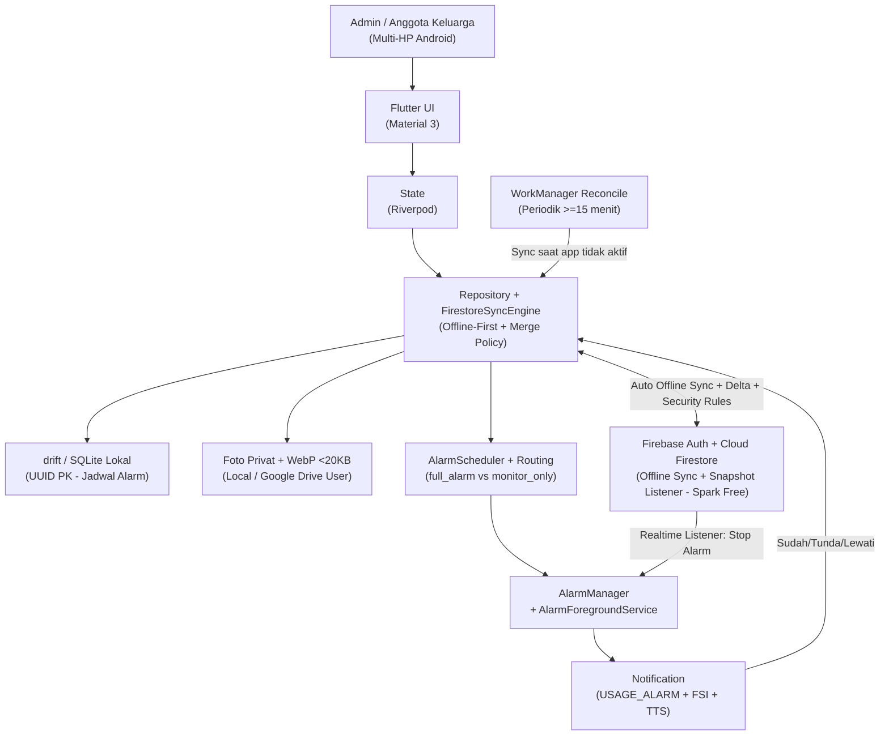
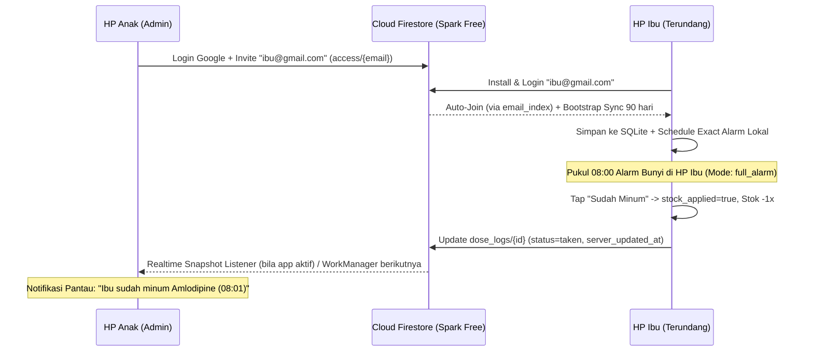

# ARCHITECTURE.md: IngatObat

## System Overview

IngatObat adalah aplikasi Android pengingat obat keluarga berarsitektur **Hybrid Offline-First dengan Backend Firebase (Google Sign-In + Cloud Firestore pada Paket Gratis Spark Plan)**. Aplikasi menggunakan SQLite lokal (`drift` dengan UUID PK) untuk menjadwalkan `AlarmManager` lokal sehingga alarm tetap 100% berbunyi walau tanpa internet. Saat pengguna *Login with Google* dan mengundang email keluarga (`FR-18`), **Cloud Firestore** menyinkronkan data lintas perangkat berkat fitur *Offline Persistence* + *Delta Sync* bawaannya, sementara **Firestore Real-time Snapshot Listener** yang aktif selama `AlarmForegroundService` berbunyi langsung menghentikan alarm di HP anggota keluarga lain begitu obat sudah diminum.

> **Keputusan arsitektur penting (Zero-Bill jujur):** Penghentian alarm lintas HP **tidak memakai FCM**. Pengiriman FCM butuh kredensial server (service account) yang tidak boleh ditanam di APK, dan relay-nya (Cloud Functions) butuh Blaze/kartu kredit. Karena itu mekanisme real-time memakai **Firestore Snapshot Listener** (gratis di Spark, berjalan di klien), dengan **rekonsiliasi latar via `WorkManager`** (≥15 menit) untuk kasus aplikasi tidak sedang aktif. FCM hanya dicatat sebagai enhancement opsional di rilis lanjutan bila tersedia relay server.

## High-Level Architecture Diagram



## Component Breakdown

### Flutter UI
- Layar: Beranda agenda hari ini, Anggota, Obat, Jadwal, Riwayat, Laporan, Kontrol RS, **Keluarga & Sinkronisasi (Login Google + Invite Email + Preferensi Alarm HP Ini)**, Pengaturan + onboarding izin.
- Komponen bersama: kartu jadwal dengan foto obat, tombol besar 48dp/64dp, indikator status sinkronisasi keluarga, banner status izin.
- Navigasi bottom 4 tab: Hari Ini, Obat, Riwayat, Lainnya.

### State Management
- Riverpod providers per repository dengan stream query drift agar UI reaktif.
- State alarm (`scheduled`/`firing`) dan state sinkronisasi (`offline_local`/`synced`/`syncing`/`error`) terpisah agar ringan.

### Repository, DAO & Firestore SyncEngine
- `MemberRepository`, `MedicineRepository`, `ScheduleRepository`, `DoseRepository`, `ControlRepository`, `SideEffectRepository`, `StockRepository`, `FamilySyncRepository`, `SettingRepository`.
- `FirestoreSyncEngine`:
  - Memanfaatkan **Cloud Firestore Offline Persistence** bawaan SDK Firebase + sinkronisasi *delta* (`updated_at > last_sync_at`) ke SQLite (`drift`) agar hemat kuota baca/tulis harian paket Spark.
  - Menyertakan thumbnail foto obat `photo_thumb_b64` (WebP `< 20 KB`) langsung di dalam dokumen Firestore `medicines/{id}` sehingga tidak memerlukan Firebase Storage berbayar.
  - **Bootstrap sync hemat kuota:** saat join pertama kali, hanya menarik `DOSE_LOG` **90 hari terakhir**; histori lama diambil on-demand saat halaman riwayat anggota dibuka. Data referensi (`members`, `medicines`, `schedules`, `control_visits`, `side_effects`) ditarik penuh karena volumenya kecil.
  - **Realtime listener hanya saat relevan:** listener pada dokumen `dose_logs/{id}` untuk dosis yang **sedang berbunyi** dipasang oleh `AlarmForegroundService`; begitu status berubah menjadi terminal (`taken`/`skipped`/`missed`), rantai eskalasi lokal dibatalkan dan listener dilepas. Ini menjaga kuota reads tetap rendah (hanya dosis aktif yang didengarkan).
  - Menggunakan ID dokumen deterministik `UUIDv5(schedule_id + scheduled_at)` pada koleksi `dose_logs` agar jika 2 HP menekan "Sudah Minum" bersamaan, hanya satu dokumen log terbentuk (*idempotent*).

### Merge & Conflict Resolution Policy
Delta sync dua arah lintas HP (yang bisa offline bersamaan) memerlukan aturan merge eksplisit:

1. **Dua timestamp:** setiap baris memiliki `updated_at` (epoch ms dari jam klien) dan `server_updated_at` (diisi `serverTimestamp()` Firestore saat dokumen berhasil ditulis online). **`server_updated_at` adalah arbiter utama**; `updated_at` hanya fallback untuk baris yang belum pernah online (clock skew HP tidak boleh memutuskan konflik).
2. **Data referensi (member/medicine/schedule/control_visit/side_effect):** *last-writer-wins* berdasarkan `server_updated_at`. Soft delete bersifat monoton: `is_archived = 1` tidak pernah bisa dibatalkan oleh update dari HP lain (mencegah data "hidup kembali").
3. **Dose log (status):** merge memakai presedensi status terminal, bukan last-write-wins murni:
   - Urutan: `pending` < `snoozed` < `skipped` < `taken`.
   - `taken` dan `skipped` bersifat **terminal dan menang** atas `pending`/`snoozed` dari HP mana pun; bila keduanya bentrok (`taken` vs `skipped`), `taken` menang.
   - `snooze_count` memakai nilai **maksimum** dari semua HP (bukan overwrite) agar batas 5x tidak bisa dilampaui lewat race.
   - `effective_scheduled_at` memakai nilai **terbaru** yang masih berstatus non-terminal.
4. **Guard stok (anti double-decrement):** kolom boolean `stock_applied` pada `dose_log` menandai apakah `dose_qty` sudah dipotong dari stok. Decrement hanya dieksekusi saat transisi `stock_applied: false → true` (transaksi atomik), terlepas dari berapa HP yang mengonfirmasi. Ini menggantikan asumsi "ID deterministik saja sudah cukup".
5. **Konflik jadwal saat salah satu HP offline:** perubahan jadwal dari HP yang lebih baru (by `server_updated_at`) menang; `AlarmManager` lokal di semua HP di-reschedule setelah merge. Perubahan yang kalah tidak hilang diam-diam — bila `updated_at` lokal > `server_updated_at` (indikasi edit offline yang lebih baru), data lokal disimpan sebagai *pending write* dan didorong ke cloud pada sinkronisasi berikutnya sebelum menerima versi server.

### drift / SQLite & Koleksi Cloud Firestore
- Tabel SQLite & Koleksi Firestore (1:1): `family_groups`, `family_member_access`, `members`, `medicines`, `schedules`, `dose_logs`, `stock_ledger`, `control_visits`, `side_effects`, `devices`, serta tabel lokal `device_member_pref` dan `setting` (lihat [DATABASE.md](file:///Users/rada/prd-ingatobat/DATABASE.md)).

### Firestore Data Model & Security Rules
Struktur koleksi dipisah per `family_id` agar rules dapat memverifikasi keanggotaan secara efisien:

```
family_groups/{familyId}
    name, owner_email, created_at, updated_at
family_groups/{familyId}/access/{emailLowercased}      // daftar undangan + role
    role ('admin'|'member'), status ('invited'|'joined'), joined_at
family_groups/{familyId}/members/{memberId}
family_groups/{familyId}/medicines/{medicineId}
family_groups/{familyId}/schedules/{scheduleId}
family_groups/{familyId}/dose_logs/{logId}
family_groups/{familyId}/stock_ledger/{ledgerId}
family_groups/{familyId}/control_visits/{visitId}
family_groups/{familyId}/side_effects/{sideEffectId}
email_index/{emailLowercased}                          // untuk auto-discover undangan saat login
    family_id, status
```

**Prinsip rules (implementasi di `firestore.rules`):**
- `isMember(familyId)` = `exists(/databases/$(database)/documents/family_groups/$(familyId)/access/$(request.auth.token.email.lower()))`.
- `isAdmin(familyId)` = dokumen akses user ber-`role == 'admin'`.
- **Read data keluarga:** hanya `isMember(familyId)`.
- **Write data operasional** (`members`, `medicines`, `schedules`, `dose_logs`, `stock_ledger`, `control_visits`, `side_effects`): `isMember(familyId)`.
- **Write ke `access/*` (invite/revoke/ubah role) dan `family_groups/*`:** hanya `isAdmin(familyId)`. Anggota tidak boleh menaikkan role dirinya sendiri.
- **`email_index/{email}`:** read hanya jika `request.auth.token.email.lower() == email` (pemilik email melihat undangannya sendiri); write hanya oleh admin grup terkait (`isAdmin(request.resource.data.family_id)`).
- **Delete account:** user boleh menghapus dokumen aksesnya sendiri (`access/{email}` miliknya) dan `email_index/{email}` miliknya; pemilik (`owner_email`) boleh menghapus seluruh dokumen grup.

### Platform Android & Per-Device Alarm Routing
- `AlarmScheduler` MethodChannel: memeriksa tabel lokal `DEVICE_MEMBER_PREF` sebelum menjadwalkan alarm:
  - Jika `alarm_mode == 'full_alarm'` (mis. di HP Ibu): jadwalkan `AlarmManager.setExactAndAllowWhileIdle` dengan suara `USAGE_ALARM` + *Full-Screen Intent* + TTS.
  - Jika `alarm_mode == 'monitor_only'` (mis. di HP Anak di kantor): tidak membunyikan weker keras; hanya menampilkan notifikasi standar saat obat diminum atau peringatan jika lewat 30 menit belum diminum (`missed`).
- `Firestore Realtime Listener`: saat `AlarmForegroundService` sedang berbunyi, ia mendengarkan dokumen `dose_logs/{id}`; jika anggota keluarga di HP lain menekan **"Sudah Minum"**, HP ini langsung membatalkan rantai `EscalationScheduler` dan menutup layar alarm detik itu juga (saat online).
- `WorkManagerSyncWorker`: rekonsiliasi periodik (≥15 menit) — menarik delta dari Firestore, memperbarui SQLite, dan me-reschedule alarm. Ini jalur pengganti FCM untuk kasus aplikasi tidak sedang aktif, dan menangani notifikasi pantau `monitor_only` secara tertunda (bukan real-time).
- `BootReceiver`: reschedule semua alarm aktif + kontrol RS (H-2 Hari 08:00 & H-1 Hari 08:00) saat `BOOT_COMPLETED`, `TIME_SET`, atau `MY_PACKAGE_REPLACED`.
- `AlarmReceiver` & `AlarmForegroundService`: menulis `DOSE_LOG` pending, menjadwalkan eskalasi +5 menit via `AlarmManager`, dan menyalakan `AlarmForegroundService` (`shortService`/`mediaPlayback`) untuk FSI (*Grouped Alarm*), suara `USAGE_ALARM`, serta Native `TextToSpeech`.

### Layanan Tambahan
- `TtsService`: Android Native `TextToSpeech` (`id-ID` offline) + `flutter_tts`.
- `WidgetService`: `home_widget` tulis agenda 5 terdekat; refresh tiap 30 menit + tiap ada sinkronisasi Firestore masuk.
- `PdfService`: generate PDF full offline.
- `AutoBackupWorker`: `WorkManager` mingguan ke folder SAF (`takePersistableUriPermission`) atau opsional ke Google Drive `appDataFolder` milik user sendiri.

## Critical Flow Sequence Diagrams



## Sync Cadence & Bootstrap (Hemat Kuota Spark)

| Kebutuhan | Mekanisme | Frekuensi | Catatan kuota |
|:---|:---|:---|:---|
| Stop alarm lintas HP | Firestore Snapshot Listener pada dosis aktif | Hanya saat alarm berbunyi | 1 listener per dosis aktif, dilepas setelah selesai |
| Reconcile saat app tidak aktif | `WorkManager` periodik | ≥15 menit | Delta kecil (`updated_at > last_sync_at`) |
| Notifikasi pantau `monitor_only` | WorkManager + saat app dibuka | Tertunda (bukan real-time) | Tidak ada biaya push |
| Bootstrap join keluarga | Delta sync terarah | Sekali saat join | `DOSE_LOG` dibatasi 90 hari |
| Real-time stop alarm (target) | Snapshot listener | Saat online & alarm aktif | < 3 detik |

## Strategi Jaminan Biaya Rp 0 di Firebase (Spark Plan Tanpa Kartu Kredit)

1. **Satu Ekosistem Google Tanpa Kartu Kredit (Firebase Spark Plan):**
   - **Firebase Auth (Google Sign-In):** 100% Gratis di Spark Plan.
   - **Cloud Firestore (Spark Plan):** Gratis 1 GiB penyimpanan + 50.000 *reads*/hari + 20.000 *writes*/hari **tanpa perlu memasukkan kartu kredit** (tidak perlu upgrade ke Blaze). Karena tidak ada kartu kredit yang terpasang, **mustahil timbul tagihan Rp 1 pun**.
   - **Cloud Functions & FCM sender TIDAK dipakai** (keduanya butuh Blaze/kartu kredit) sehingga tidak ada komponen berbayar di jalur kritis.
2. **Real-time Stop Alarm Tanpa Server:**
   - Ketika alarm berbunyi, `AlarmForegroundService` mendengarkan dokumen `dose_logs/{id}` secara langsung via **Firestore Real-time Listener**, sehingga alarm di HP lain langsung mati otomatis saat obat dikonfirmasi. Tidak ada Cloud Functions, tidak ada secret server.
3. **Tanpa Biaya Cloud Storage Foto:** Foto obat disinkronkan menggunakan **Thumbnail Mikro WebP (`< 20 KB`)** langsung di dalam dokumen Firestore `medicines`, sementara file foto asli disimpan di HP lokal / Google Drive `appDataFolder` milik user.

## Scalability

- Satu device, target < 20 anggota, < 200 obat, < 50 ribu log; SQLite cukup.
- Jika log > 100 ribu, arsip otomatis per tahun ke tabel arsip lokal (tidak ikut delta sync harian).

## Dev & Build Pipeline

- `flutter analyze`, `flutter test` (unit repo + widget kunci), `dart format`.
- Build: `flutter build appbundle --release`; verifikasi izin di merged manifest; upload ke Play Console internal dulu.
